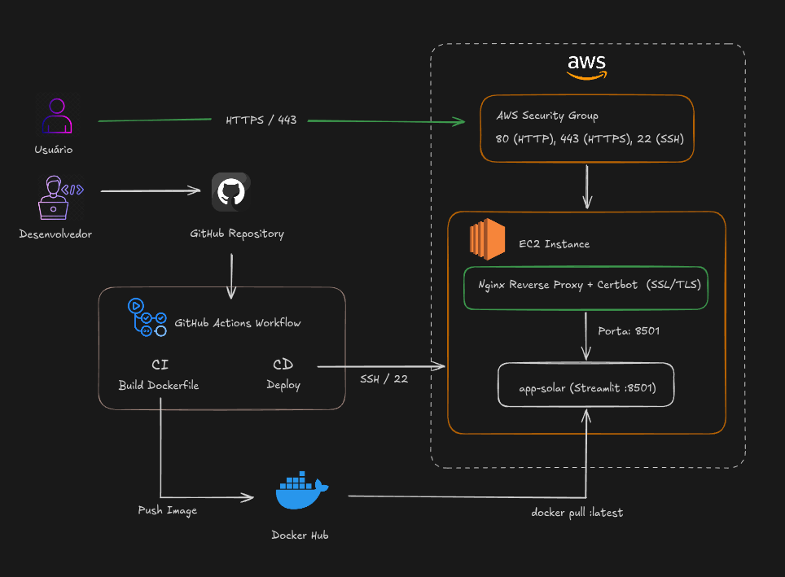

## Dimensionador Solar — Quantitativo de Painéis por Inversor

Aplicação desenvolvida em **Python** para automação de dimensionamento fotovoltaico, validação de segurança elétrica em inversores/módulos e otimização de arranjos de entrada MPPT.

O projeto é totalmente conteinerizado com **Docker**, integrado a uma esteira automatizada de **CI/CD no GitHub Actions** e hospedado na nuvem **AWS (EC2)** sob um proxy reverso **Nginx** com criptografia **HTTPS (SSL/TLS)**.

### 🌐 Aplicação em Produção
- **URL Segura (HTTPS):** [Acessar Dimensionador Solar](https://dimensionador-solar-enzo.duckdns.org) 
- **Endereço IP AWS:** `http://3.23.128.112`

