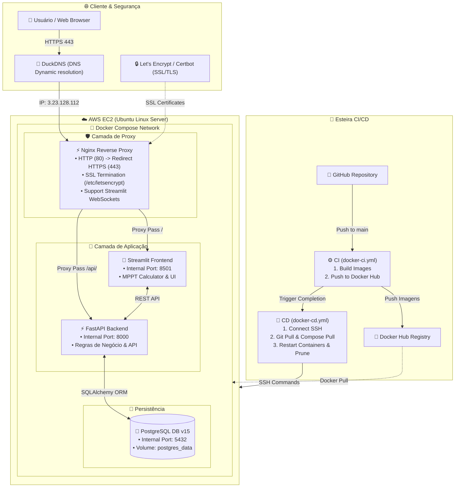

  
<b>Dimensionador Solar v2.0.0</b> — Sistema Web de Dimensionamento Fotovoltaico & Compatibilidade MPPT

  <a href="https://github.com/EnzoAndradeF/dimensionador-solar/issues/new?assignees=&labels=bug&template=01_BUG_REPORT.md&title=bug%3A+">Reportar um Bug</a>
  ·
  <a href="https://github.com/EnzoAndradeF/dimensionador-solar/issues/new?assignees=&labels=enhancement&template=02_FEATURE_REQUEST.md&title=feat%3A+">Solicitar uma funcionalidade</a>
  ·
  <a href="https://dimensionador-solar.duckdns.org">Acessar Aplicação em Produção</a>

   

  <!-- Status & Deploy -->
  
  
  

  <!-- Stack Tecnológica Core -->
  
  
  
  
  
  

 

## Sobre o projeto

O **Dimensionador Solar** é uma plataforma web completa projetada para simplificar e automatizar o cálculo de dimensionamento de sistemas geradores fotovoltaicos. A aplicação permite a seleção de módulos solares, inversores e controladores MPPT, realizando a verificação de compatibilidade elétrica e o dimensionamento térmico e de strings em tempo real.

O projeto evoluiu de um script monolítico para uma **arquitetura moderna em microsserviços conteinerizados**, orquestrados via Docker Compose, com terminação SSL/TLS (HTTPS) nativa via Nginx/Certbot, persistência de dados em PostgreSQL e integração contínua (CI/CD) desacoplada no GitHub Actions.

Funcionalidades do **Dimensionador Solar**:

- Calculadora de dimensionamento de inversores e entradas MPPT.
- Módulo de verificação de compatibilidade de painéis solares.
- Interface reativa construída em Streamlit com navegação lateral.
- API REST assíncrona em FastAPI para processamento de regras de negócio.
- Banco de dados relacional PostgreSQL 15 com persistência via Docker Volume.
- Reverse Proxy Nginx configurado com HTTPS (porta 443) e WSS (WebSockets).
- Certificados SSL/TLS gratuitos com renovação automática via Certbot (Let's Encrypt).
- Domínio personalizado via DuckDNS (`dimensionador-solar.duckdns.org`).
- Esteiras de CI/CD separadas: Build & Push de imagens no Docker Hub e Deploy via SSH na AWS EC2.

### Stacks 

- [Python 3.11](https://www.python.org/)
- [FastAPI](https://fastapi.tiangolo.com/)
- [Streamlit](https://streamlit.io/)
- [PostgreSQL 15](https://www.postgresql.org/)
- [Docker & Docker Compose](https://www.docker.com/)
- [Nginx](https://nginx.org/)
- [AWS EC2](https://aws.amazon.com/ec2/)
- [DuckDNS](https://www.duckdns.org/) & [Let's Encrypt / Certbot](https://certbot.eff.org/)
- [GitHub Actions](https://github.com/features/actions)

## Arquitetura e infraestrutura 

